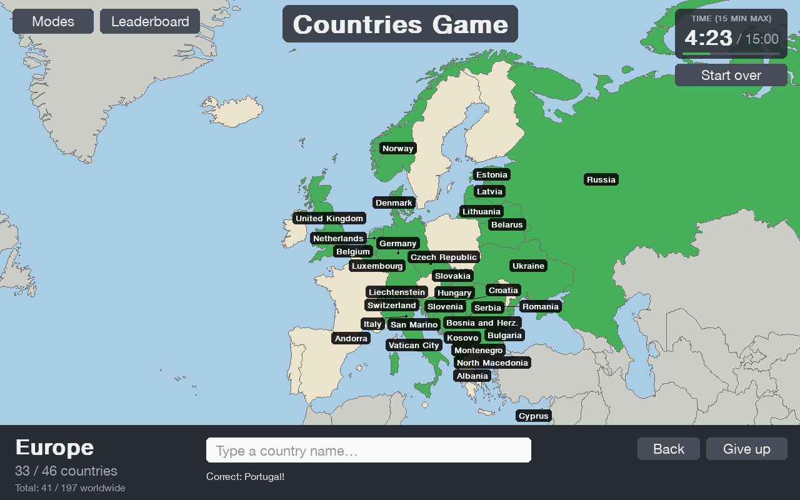
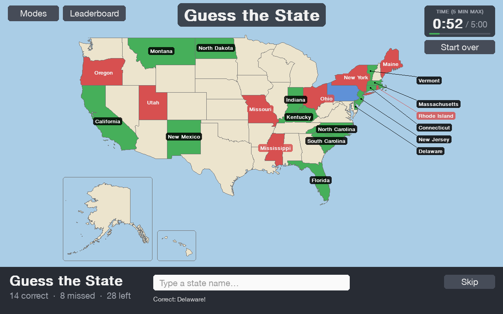
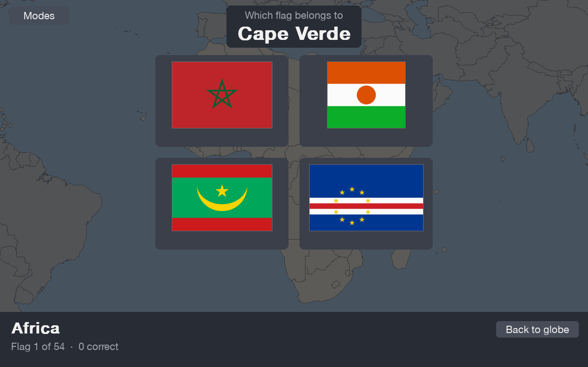

# World Map Game

A geography quiz game in Python and pygame. Name every country in the world against the clock, learn flags and
capitals, or switch to the USA and test yourself on the 50 states.



## Modes

Pick a mode from the **Modes** menu in the top-left corner.

**World**

| Mode | Learn | Game |
|---|---|---|
| Countries | Hover over a country to see its name and flag | Type the names of all 197 countries in 15 minutes. Click a continent to zoom in. |
| Flags | Hover over a country to see its flag, or take a practice test | Pick the right flag for every country in a continent. Get them all right to turn it green. |
| Capitals | Hover over a country to see its capital, or take a practice test | Pick the right capital for every country in a continent |

**USA**

| Mode | Learn | Game |
|---|---|---|
| States | Hover over a state to see its name and flag | Type all 50 states in 5 minutes |
| State Flags | Hover over a state to see its flag, or take a practice test | Pick the right flag for all 50 states |
| State Capitals | Hover over a state to see its capital, or take a practice test | Pick the right capital for all 50 states |
| Guess the State | | A state is highlighted: type its name. One try per state, 5 minutes. |
| Guess the Capital | | A state is highlighted: type its capital. One try per state, 5 minutes. |

The timed games (Countries, States, Guess the State and Guess the Capital) each have their own top 10 leaderboard.




## Tips

- Names autocomplete after 3 letters. Press **Tab** or **→** to accept a suggestion, and **↑/↓** to see others.
- The timer starts with your first answer.
- In Guess the State and Guess the Capital, press **Space** before typing to come back to a state later. Small
  northeastern states get a **Zoom in** button.

## Run it

You need Python 3.10 or newer.

```
pip install -r requirements.txt
python world_map.py
```

## How the code is organised

`world_map.py` starts the game; the code is in the `worldmap` package:

| File | What's in it |
|---|---|
| `config.py` | Window size, colours, map views, time limits, file paths, the list of modes |
| `data.py` | Countries and US states: loading them, accepted names |
| `geo.py` | Turning longitude/latitude into screen pixels, drawing the map |
| `storage.py` | Scoreboards and flag/capital progress |
| `scope.py` | One map you play on (the world or the USA) and its game in progress |
| `ui.py`, `labels.py`, `scoreboard.py`, `menu.py` | Buttons, cards, the timer, name tags, the Top 10 screens, the Modes menu |
| `app.py` | The window, main loop, zooming and switching modes |
| `modes/` | One class per kind of mode: `naming.py` (Countries/States game), `guess.py` (Guess the State/Capital), `quiz.py` (multiple choice), `learn.py` (Learn modes) |

## Build a Windows .exe

On a Windows PC with Python installed, double-click `build_windows.bat`. It installs what it needs and builds
`dist\World Map Game.exe`, a single file you can share. Windows may show "Windows protected your PC" the first time:
click **More info → Run anyway**.

## Credits

- Country and state shapes, and capitals: [Natural Earth](https://www.naturalearthdata.com/) (public domain)
- Flags: [Flagpedia / flagcdn.com](https://flagpedia.net/)
